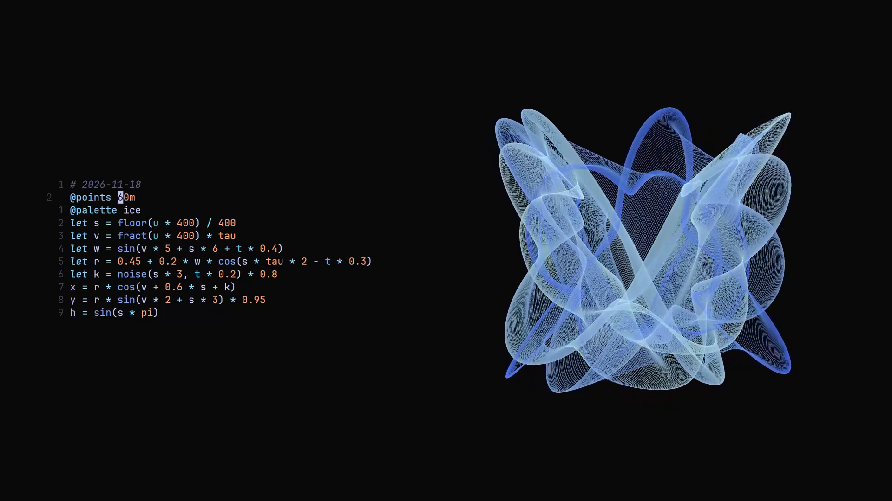

# kasumi 霞

kasumi compiles short math formulas into cuda kernels and draws the result as tens of millions of points per frame. brightness is the log of how many points hit a pixel, which is the display method from the fractal flame algorithm. it runs on an rtx 5060 laptop.



a form is a text file, and this one has 10 lines.

```text
@points 60m
@palette ice
let s = floor(u * 400) / 400
let v = fract(u * 400) * tau
let w = sin(v * 5 + s * 6 + t * 0.4)
let r = 0.45 + 0.2 * w * cos(s * tau * 2 - t * 0.3)
let k = noise(s * 3, t * 0.2) * 0.8
x = r * cos(v + 0.6 * s + k)
y = r * sin(v * 2 + s * 3) * 0.95
h = sin(s * pi)
```

save the file and the live window recompiles it in about 175 ms. if the new version does not compile, the old one keeps running and the error shows on screen.

## build

you need an nvidia gpu, rust, and nvrtc (the runtime cuda compiler). the cuda toolkit is not needed.

```sh
python -m pip install --target .cuda nvidia-cuda-nvrtc-cu12
cargo build --release
./target/release/kasumi live forms/silk.ks
```

video export uses ffmpeg with nvenc. kasumi has only been tested on windows 11 so far.

## commands

| command | what it does |
|---|---|
| `kasumi live <form>` | live window with hot reload |
| `kasumi render <form> --res 4k --points 200m --sub 8` | 4k still with motion blur |
| `kasumi render <form> --seconds 10` | video, h264 by default, `--codec hevc` for a 10-bit master |
| `kasumi check <forms>` | compares gpu output with the cpu reference interpreter |
| `kasumi bench [forms]` | times the three accumulation kernels |
| `kasumi ptx <form>` | writes the generated cuda and ptx next to the form |
| `kasumi grid <form>` | 4 x 4 live mutations, click to like, right click to breed |
| `kasumi taste` | trains the taste model on your clicks |
| `kasumi evolve [seeds] --minutes 480` | evolves forms and writes a gallery page |
| `kasumi pane <plan.json> <out.mp4>` | renders the canvas for a recorded editing session |

keys in the live window are listed under `/`.

## the language

inputs are `i` (point index), `n` (point count), `t` (seconds), `u` (`i / n`), `r1` and `r2` (random per point), and `px` and `py` (the previous point).

`x` and `y` are required. `z` drives depth of field, `b` is brightness and `h` is a 0 to 1 hue.

math is `+ - * / % ^` and sin cos tan tanh atan2 sqrt abs fract floor sign min max mix clamp smoothstep mag exp log pow noise rnd.

settings are `@points`, `@palette`, `@zoom`, `@cx`, `@cy`, `@gamma`, `@vibrancy`, `@heat`, `@exposure`, `@trail`, `@dof`, `@focus`, `@shutter`, `@bloom`, `@de`, `@iters`, `@warmup` and `@fastmath`. palettes are mono, ember, ice, sakura, moss, ink, dusk and jade.

`@de 12` turns on adaptive density estimation, which blurs sparse pixels by up to 12 pixels and leaves dense ones sharp. it removes grain at low point counts and softens single threads, so it is off by default.

a form that reads `px` or `py` runs as an iterated system, and each gpu thread walks its own orbit. `forms/clifford.ks` works this way.

`i` is a float32 and is only exact up to 16.7 million, so use `u`, `r1` or `r2` at high point counts.

## how it works

`kasumi-lang` has a hand-written pratt parser and an ssa ir. values are hash-consed while the ir is built, so common subexpressions merge on the way in. it also folds constants, removes dead code and moves anything that does not depend on the point out of the kernel. the cpu computes those values once per frame.

`kasumi-gpu` loads the cuda driver and nvrtc at run time. reload goes through ptx and the driver jit, which measured 2 to 3 times faster here than the cubin path inside nvrtc.

`kasumi-explore` mutates the syntax tree, throws out blank, blown out, frozen, noisy, flat and cropped forms, and keeps the best form per style cell in a map-elites archive. `taste/siglip.py` is an optional taste model on siglip or clip embeddings, and `kasumi evolve --novelty-on embed` uses the same embeddings to measure novelty.

## numbers

rtx 5060 laptop, 26 sms, 100m points per frame, median of 5 frames. values are billions of points per second.

3840 x 2160 accumulation buffer:

| form | naive | warp | tile bin | bin / naive |
|---|---|---|---|---|
| silk | 21.5 | 28.3 | 8.6 | 0.40 |
| rose | 15.8 | 15.3 | 5.6 | 0.35 |
| knot | 16.6 | 16.2 | 6.7 | 0.40 |
| tiny | 27.1 | 20.9 | 6.3 | 0.23 |
| clifford | 6.9 | 6.8 | 5.6 | 0.81 |
| ink | 2.2 | 2.2 | 4.0 | 1.82 |

7680 x 4320 accumulation buffer (4k with 2x supersampling):

| form | naive | warp | tile bin | bin / naive |
|---|---|---|---|---|
| silk | 23.4 | 33.2 | 8.1 | 0.35 |
| rose | 12.8 | 18.7 | 6.1 | 0.48 |
| knot | 12.7 | 14.0 | 7.1 | 0.56 |
| tiny | 25.9 | 17.9 | 5.5 | 0.21 |
| clifford | 0.92 | 0.83 | 4.52 | 4.93 |
| ink | 1.26 | 1.26 | 3.68 | 2.93 |

tile binning loses on smooth forms and wins when points scatter across a buffer bigger than the l2 cache. `live` and `render` time all three kernels on each form and use the fastest.

the taste model has not been measured on real clicks yet, and no full overnight run has been judged.

kasumi is released under the mit license, see [LICENSE](LICENSE) for the text.
