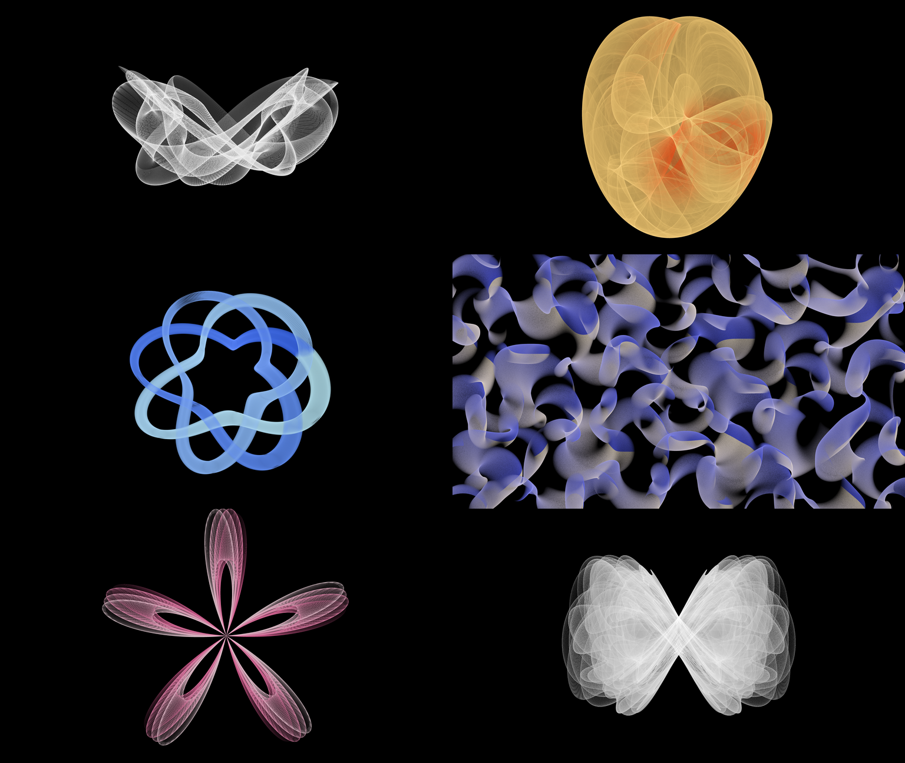
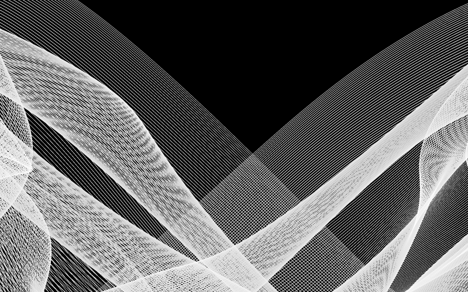
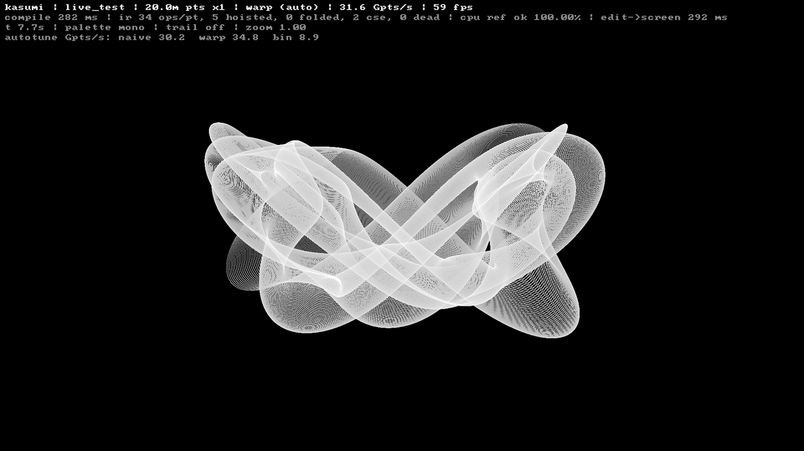
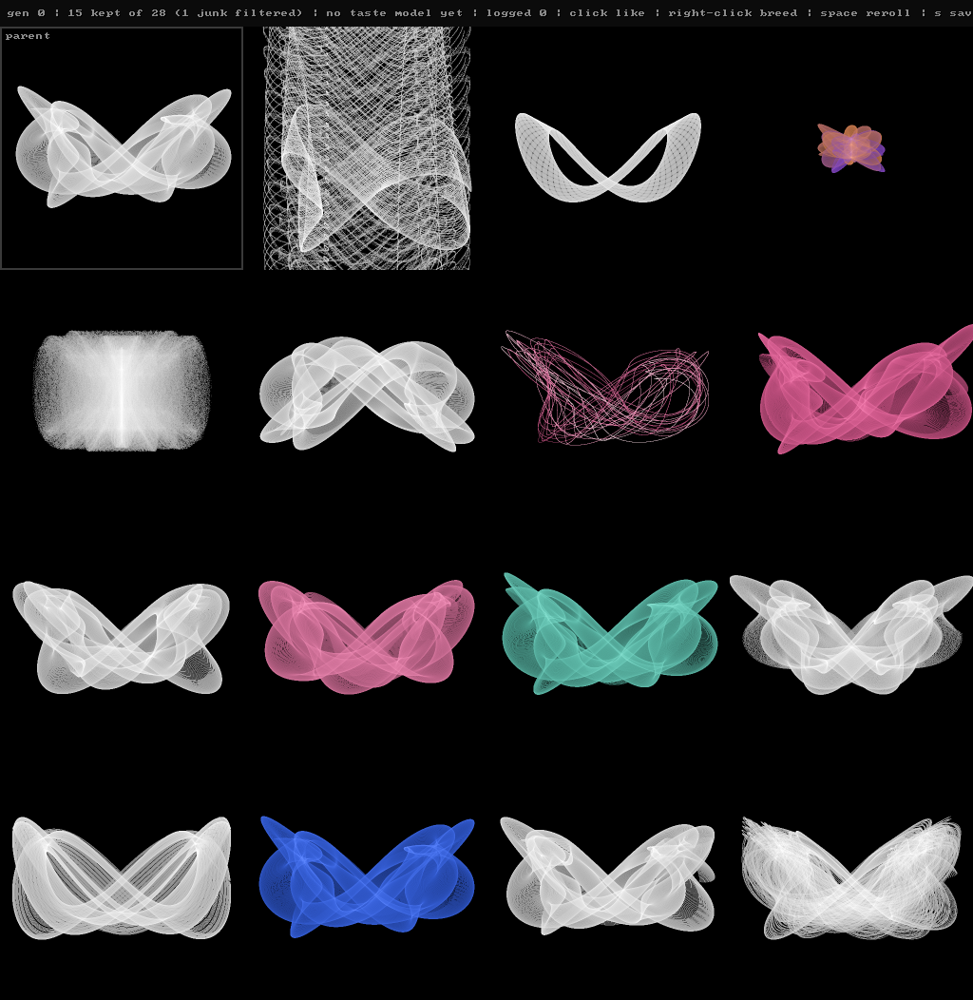

# kasumi 霞

A GPU engine for generative point art. A form is a few lines of math that say where point `i` sits at time `t`. kasumi compiles the form to a CUDA kernel at run time and draws tens of millions to billions of points per frame. Brightness is the log of how many points land on each pixel (the fractal-flame display method), so dense regions glow and single threads stay visible.



```text
# silk: four hundred strands, each a slow wave, braided by time
@points 20m
param strands = 400
param k = 3
let s = floor(u * strands) / strands
let v = fract(u * strands) * tau
let w = sin(v * k + s * 6 + t * 0.4)
let r = 0.5 + 0.22 * w * cos(s * tau * 2 - t * 0.3)
x = r * cos(v + 0.6 * s + 0.15 * sin(t * 0.2)) * 1.25
y = r * sin(v * 2 + s * 3) * 0.6 + 0.08 * sin(s * tau * 3 + t)
```



## Quick start

Requirements: an NVIDIA GPU and driver, Rust, and NVRTC. NVRTC is the runtime CUDA compiler. The full CUDA toolkit is not needed. Video export also needs ffmpeg (`winget install Gyan.FFmpeg`); kasumi finds a winget install even before PATH refreshes.

```sh
python -m pip install --target .cuda nvidia-cuda-nvrtc-cu12   # nvrtc only, ~90 MB
cargo build --release
./target/release/kasumi info
./target/release/kasumi live forms/silk.ks        # edit the file and save: it recompiles live
```

| command | what it does |
|---|---|
| `kasumi live <form>` | Live window with hot reload. If a save fails to compile, the old form keeps running and the error is shown on screen. |
| `kasumi render <form> --res 4k --points 200m --sub 8` | 4K still with 8 motion-blur subframes (1.6 billion points). |
| `kasumi render <form> --seconds 10 --fps 60` | Video via ffmpeg + NVENC. The default is H.264, which plays everywhere. `--codec hevc` gives a 10-bit HEVC master (Windows needs the paid HEVC extension to play it) and `--codec av1` gives 10-bit AV1. Without ffmpeg it writes PNG frames. |
| `kasumi check <forms>` | Compares GPU point positions against the CPU reference interpreter. |
| `kasumi bench [forms]` | Naive vs warp vs tile-binning accumulation, and checks that all three produce the same image. |
| `kasumi ptx <form>` | Writes out the generated CUDA and PTX, plus IR pass statistics. |
| `kasumi grid <form>` | 4×4 live mutations. Click to like, right-click to breed. |
| `kasumi taste` | Trains the taste model on your clicks and reports held-out ranking accuracy. |
| `kasumi evolve [seeds] --minutes 480` | Overnight evolution, ending in `runs/<id>/gallery/index.html`. Add `--taste siglip` to score with the image-embedding model. |

### Live window keys

space pause · r reset · ←/→ time speed · ↑/↓ points ×2 · m accumulation kernel · a autotune · f fast-math · p palette · t feedback trails · b motion blur · wheel zoom · drag pan · s screenshot · e 4K still of this exact moment (1.6 billion points) · h HUD · / help



## The language

- **Inputs:** `i` (point index), `n` (point count), `t` (seconds), `u = i / n`, `r1` and `r2` (two independent uniform randoms per point, hashed from the integer index), and `px` / `py` (the previous point; see attractors below).
- **Outputs:** `x` and `y` are required. `z` is optional and drives depth of field, `b` is brightness weight, and `h` is a 0–1 hue mapped through the palette.
- **Statements:** `let name = expr` for intermediates. `param name = 3.2` for constants the explorer can tune.
- **Math:** `+ - * / % ^`, sin cos tan tanh atan2 sqrt abs fract floor sign min max mix clamp smoothstep mag exp log pow, `noise(x, y)` (simplex), and `rnd(x)`.
- **Settings:** `@points 20m`, `@palette ember` (mono ember ice sakura moss ink dusk jade), `@zoom`, `@cx`, `@cy`, `@gamma`, `@vibrancy`, `@heat`, `@exposure`, `@trail`, `@dof`, `@focus`, `@shutter`, `@iters`, `@warmup`, `@fastmath on`.
- **Attractor mode:** a form that reads `px` / `py` becomes an iterated system. Each GPU thread walks its own chaotic orbit for `@iters` steps. This is how `forms/clifford.ks` works.
- **Precision:** `i` is a float32, so it is exact only up to 16.7M. Use `u`, `r1` or `r2` for smooth parameterisations at high point counts.

Errors point at the exact spot and suggest fixes:

```text
9:9: unknown function 'sinn' (did you mean 'sin'?)
  let w = sinn(v * k + s * 6 + t * 0.4)
          ^
```

## How it works

```text
form.ks ─► pratt parser ─► AST ─► SSA IR ─► passes ─► CUDA C ─► NVRTC ─► PTX ─► driver JIT ─► kernel
                            │                 │
                            │                 └─ fold · CSE (hash-consing) · dead code · hoisting
                            └─ the mutator edits this tree and prints it back as a form file
```

- **Compiler (`kasumi-lang`).** A hand-written parser and an SSA IR. Common-subexpression elimination comes for free from hash-consing, and constant folding runs while the IR is built. Everything that does not depend on the point (`t`, params, anything built only from them) is hoisted out of the kernel. The CPU evaluates those values once per frame, or per motion-blur subframe, and the kernel reads them from a small table. A CPU interpreter of the same IR, written in f32 with the same hash and noise code as the CUDA prelude, is the correctness reference.
- **Runtime (`kasumi-gpu`).** Loads the CUDA driver API and NVRTC dynamically, so the build needs no CUDA toolkit. Every launch takes one `repr(C)` struct, mirrored in CUDA.
- **Explorer (`kasumi-explore`).**
  - Mutations work on the syntax tree: nudge a param or a literal, swap a function for a sibling, add or remove a wave term, cross over with another form, change palette or colour.
  - Junk filters reject forms that are blank, blown out, frozen, noise, a flat slab, or cropped by the frame edge.
  - The taste model is logistic regression on image features.
  - The archive is MAP-Elites: one champion per style cell, so evolution cannot collapse into one look.



## Results on an RTX 5060 Laptop GPU (26 SMs, sm_120)

| PRD check | target | measured |
|---|---|---|
| live preview | 1080p, 60 fps, ≥20M points | **59 fps at 20M points** (14–32 Gpts/s depending on form) |
| 4K export | 200M points × 8 subframes, ≥1 frame/s | **2–20 frames/s** for every form (silk 50 ms per frame, clifford 376 ms, ink 512 ms). End to end, including the 10-bit HEVC encode, silk 4K video runs at **13 frames/s**, so a 60-second 4K reel takes about 4.5 minutes. |
| edit to screen | under 300 ms | **~175 ms** on new code (was 320 ms; see below) |
| correctness | GPU matches the CPU reference | **100% of 10,000 sampled points**, max relative error ≤ 2e-7 (strict), all 6 forms |
| tile binning | ≥3× naive points/s | **4.9× (clifford) and 2.9× (ink) at 4K export**, but 0.2–0.6× on coherent forms. See findings. |
| taste model | held-out AUC ≥ 75% | not measured yet: needs about 500 of your clicks (`kasumi grid`, then `kasumi taste`) |
| overnight run | ≥50 forms you'd post | not run yet. A 10-minute run evaluated 1,440 forms and filled 43 of 64 style cells. |

### Accumulation kernels

Values are Gpts/s, the median of 5 frames at 100M points per frame. "match" means the bin-mode image is identical to naive.

**3840×2160 accumulation buffer (33 MB):**

| form | lit | naive | warp | bin | bin vs naive |
|---|---|---|---|---|---|
| silk | 12% | 23.9 | **27.9** | 8.1 | 0.34× |
| rose (22,506-point hot pixel) | 11% | 15.5 | **16.6** | 5.3 | 0.34× |
| knot | 14% | 14.3 | **17.2** | 6.3 | 0.44× |
| clifford (attractor) | 29% | **6.3** | **6.3** | 5.2 | 0.82× |
| ink (random scatter) | 71% | 2.2 | 2.2 | **4.0** | **1.82×** |

**7680×4320 accumulation buffer, which is 4K with 2× supersampling (133 MB):**

| form | naive | warp | bin | bin vs naive |
|---|---|---|---|---|
| silk | 23.3 | **29.2** | 7.8 | 0.34× |
| clifford | 0.92 | 0.83 | **4.52** | **4.93×** |
| ink | 1.26 | 1.26 | **3.68** | **2.93×** |

In every row, the bin-mode image matches naive. Unweighted forms match bit-exactly. Forms with a brightness weight `b` differ by up to 1e-4 relative, because float sums are added in a different order.

### Findings (the blog post)

1. **Contention is not the problem; locality is.** The PRD expected hot pixels to be the bottleneck. Rose piles 22,506 points onto one pixel and naive atomics still run at 15 Gpts/s. Consecutive points along a curve hit neighbouring addresses, and L2 merges those atomics. Ink, the form *without* hot spots, is the slowest: random scatter means one cache-line miss per point.
2. **Coherent forms are compute-bound.** On silk, binning's first pass alone (one formula evaluation per point) costs about as much as the whole naive render. No multi-pass scheme can win there.
3. **Binning wins once the image outgrows L2.** At 4K with 2× supersampling, the 133 MB buffer is 4× the L2 cache. Random atomics then go to DRAM and binning wins 2.9–4.9×.
4. **Binning v1 evaluated the formula twice** (count, then scatter). v2 stages each point's packed key during the count pass and makes scatter a form-independent data-movement kernel. That took ink from 1.56× to 1.84×. Moving the count and scatter passes to 512-thread blocks added another 5–15%: each block holds a 40 KB tile histogram, so 256-thread blocks left SMs at low occupancy. The remaining limit is scatter coalescing. Diffuse points touch about 1,000 of 8,160 tiles per round, so their writes cannot merge. Fixing that means coarser buckets plus a second sorting pass, and accumulation tiles larger than the 48 KB default shared memory. That is the v1 kernel project.
5. **Warp aggregation** (`__match_any_sync`, one atomic per distinct pixel in a warp) is a cheap +10–45% on coherent forms. No single kernel wins everywhere, so `live` and `render` autotune per form by timing all three.
6. **Hot-reload latency was dominated by ptxas.** It wasn't parsing or NVRTC's front end. The front end takes ~13 ms; ptxas inside NVRTC takes 170–290 ms. Changes that reached 175 ms:
   - emit PTX and let the driver JIT it (2–3× faster than NVRTC's cubin path)
   - inline the formula once per kernel instead of twice (warmup and main loops fused)
   - leave the tile-binning kernels out of the hot path and compile them on demand

   Both NVRTC and the driver keep source-keyed caches, so a re-save of unchanged kernel code takes about 15 ms. Benchmark only with genuinely new code.

## Changes from the PRD

- **Own FFI instead of `cudarc`.** About 150 lines of dynamic driver/NVRTC bindings, with no version coupling. **`minifb` instead of `winit` + `pixels`**, which is simpler for a CPU-copied frame (that is the PRD's own "start with copying" plan).
- **Two taste models.** `kasumi taste` trains a Rust logistic regression on hand-built image features (layout, radial profile, gradient orientation, symmetry), and `kasumi grid` uses it. The PRD's SigLIP/CLIP model is the Python sidecar below, used by `evolve --taste siglip`. Both train from the same `explore/clicks.jsonl`.
- **Gallery clips.** "Looping clips" are CSS-animated PNG sprite strips, so the gallery needs no video encoder and is one static folder.
- **Filter thresholds.** "Blown out" requires a bright frame as well as >60% lit pixels, so deliberate full-frame forms like ink survive. A "flat slab" filter was added because early evolution kept producing solid rectangles.

## Additions beyond the PRD

- **Attractor mode** (`px` / `py`): strange attractors and iterated systems, the real flame look.
- **Feedback trails** (`t` key or `@trail 0.9`): the image decays instead of clearing.
- **Live kernel switching and autotune**, with the speed of each kernel shown in the HUD.
- **One-key 4K still of the current moment** (`e`).
- **Hue packing.** The accumulation buffer stores count + hue-sum, not RGB, and the palette is applied in the tone map. That halves the bandwidth.

## Image-embedding taste model (SigLIP / CLIP)

```sh
python -m venv .venv
.venv/Scripts/python -m pip install torch torchvision --index-url https://download.pytorch.org/whl/cu128
.venv/Scripts/python -m pip install open_clip_torch scikit-learn pillow numpy

.venv/Scripts/python taste/siglip.py compare          # siglip vs clip on your clicks (the PRD's open question)
.venv/Scripts/python taste/siglip.py train --model siglip
kasumi evolve --taste siglip --minutes 480
```

Embeddings are cached per thumbnail in `explore/`. Evolve keeps one sidecar process alive and scores each batch's thumbnails in one round trip.

## Layout

```text
crates/kasumi-lang     parser, ir, passes, cuda codegen, cpu interpreter (+ tests)
crates/kasumi-gpu      dynamic cuda/nvrtc ffi, accumulation kernels, tone map
crates/kasumi-explore  mutation, features, filters, taste model, archive (+ tests)
crates/kasumi-cli      live, render, bench, check, ptx, grid, taste, evolve, gallery
taste/siglip.py        image-embedding taste sidecar
forms/                 seed forms
```

`KASUMI_PROF=1` prints per-stage timings for tile binning and hot reload.
